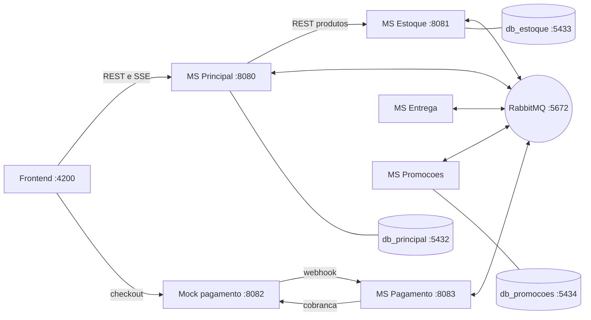
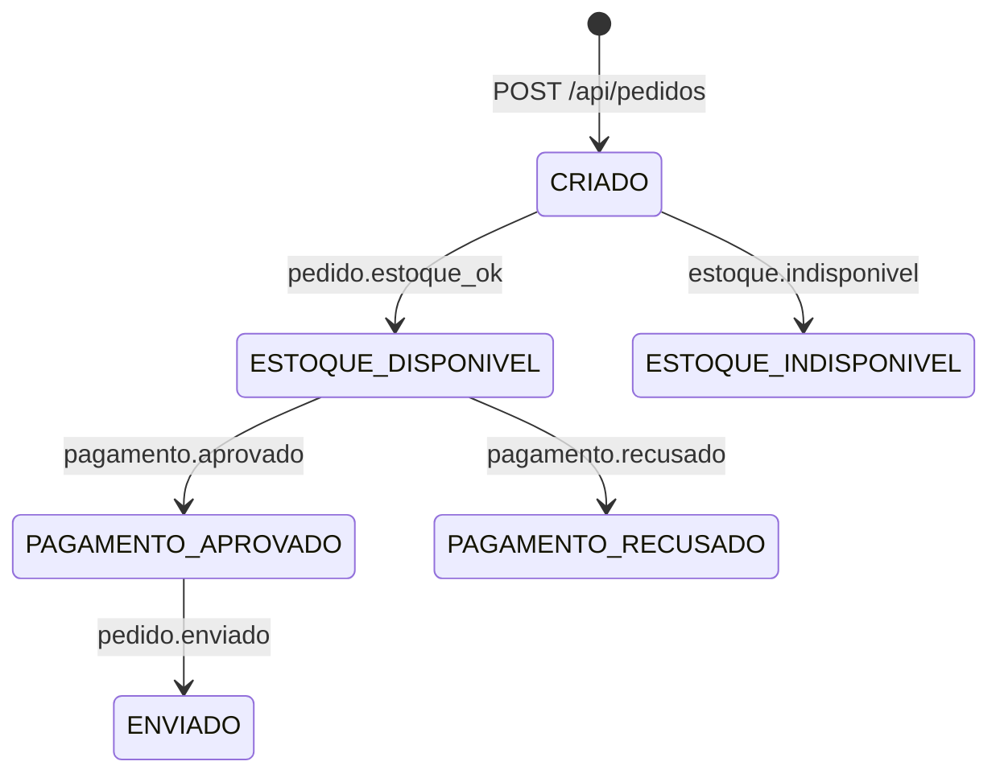

# Backend (microsserviços)

Este documento explica como o backend está organizado: cada microsserviço, os bancos de dados, a infraestrutura e o fluxo do pedido. Para o detalhe das filas, dos eventos e da segurança das mensagens, veja [`rabbitmq-e-eventos.md`](rabbitmq-e-eventos.md). Para o lado do navegador, veja [`frontend.md`](frontend.md). A referência de uso da API REST está em `USOAPI.md`.

## 1. Visão geral

O sistema é composto por cinco microsserviços em Go, um mock de pagamento, três bancos PostgreSQL e um broker RabbitMQ. Cada serviço tem uma responsabilidade e se comunica de quatro formas:

| Canal | Onde é usado |
|---|---|
| **REST** | Frontend → Principal; Principal → Estoque (lista de produtos) |
| **RabbitMQ** (eventos assíncronos) | Entre todos os microsserviços (fluxo do pedido e promoções) |
| **Webhook HTTP** | Mock de pagamento → MS Pagamento |
| **SSE** | Principal → Frontend (mudanças de situação em tempo real) |

Princípio de projeto: **cada serviço tem o seu próprio banco** (o Pagamento e a Entrega não têm). Um serviço nunca lê o banco de outro; a troca de informação é por REST ou por evento.

## 2. Portas e endereços

| Componente | Endereço | Observação |
|---|---|---|
| Frontend | `localhost:4200` | `ng serve` |
| MS Principal | `:8080` | API REST em `/api` e SSE em `/api/eventos` |
| MS Estoque | `:8081` | API REST interna (`ESTOQUE_ADDR` altera) |
| Mock de pagamento | `:8082` | `MOCK_PAGAMENTO_ADDR` altera |
| MS Pagamento (webhook) | `:8083` | `PAGAMENTO_ADDR` altera |
| MS Entrega e MS Promoções | sem HTTP | só RabbitMQ (Promoções também chama a API externa de e-mail) |
| RabbitMQ | `5672` (AMQP), `15672` (painel) | usuário `guest` no código |
| Bancos | `5432` (principal), `5433` (estoque), `5434` (promoções) | portas vindas do `.env` |

## 3. Microsserviços

### 3.1 MS Principal (gateway e pedidos)

**Papel:** ponto de entrada do frontend, dono dos pedidos e emissor do SSE.

**API REST** (resumo; detalhes em `USOAPI.md`):

| Método | Rota | Descrição |
|---|---|---|
| GET | `/api/produtos` | Repassa a consulta ao MS Estoque |
| POST | `/api/pedidos` | Cria pedido |
| GET | `/api/pedidos` | Lista pedidos (filtro `?situacao=`) |
| GET | `/api/pedidos/{id}` | Consulta um pedido |
| DELETE | `/api/pedidos/{id}` | Exclui pedido |
| GET | `/api/eventos` | Stream SSE |
| POST / DELETE | `/api/promocoes/interesse` | Cadastra / cancela interesse em promoções |

**Como cada operação funciona:**

- **Criar pedido:** valida o JSON (`itens` obrigatório, `quantidade >= 1`) e, dentro de **uma transação**, insere o pedido (`CRIADO`) e seus itens. Produto inexistente (violação de chave estrangeira) e item duplicado (violação de chave única) viram `400`. Só **depois do commit** publica o evento `pedido.criado` e responde `201`.
- **Listar produtos:** não usa banco próprio. Chama `GET {ESTOQUE_URL}/produtos` (padrão `http://127.0.0.1:8081`), com timeout de 5 s e limite de 1 MB, valida que a resposta é JSON e a devolve como veio. Se o estoque falhar, responde `500`.
- **Excluir pedido:** verifica se existe (`404` se não), apaga (os itens saem junto, por `ON DELETE CASCADE`) e publica `pedido.excluido` para o Estoque devolver as reservas. Responde `204`.
- **Interesse em promoções:** valida o e-mail, define a ação (`CADASTRAR` ou `CANCELAR`) e publica `interesse.promocao`. O processamento é assíncrono (quem grava é o MS Promoções).
- **Consumidor de eventos:** lê a fila `principal` e reage a seis eventos (tabela na seção 7). A cada um, atualiza a situação no banco e faz `broadcast` no SSE.

**Detalhes de implementação:**

- Dois canais AMQP separados (um para publicar, outro para consumir). Como o canal de publicação não é seguro para uso concorrente, existe um `Mutex` em volta de cada `publicar()`.
- CORS liberado só para `http://localhost:4200`, com os métodos `GET`, `POST`, `DELETE` e `OPTIONS`.
- Encerramento (Ctrl+C) com *graceful shutdown* de 5 s. É normal aparecer `context deadline exceeded` nesse momento se houver conexões SSE abertas, porque elas são de longa duração.

### 3.2 MS Estoque

**Papel:** dono do saldo dos produtos e das reservas.

- **API REST** (`:8081`): `GET /produtos`, com os filtros `nome_like` (parcial, sem diferenciar maiúsculas) e `id` (repetível). Só devolve produtos com saldo **maior que zero** (`quantidade - reservados > 0`). Campos devolvidos: `id`, `nome`, `categoria`, `quantidadeDisponivel`.
- **Consome** (fila `estoque`): `pedido.criado` e `pedido.excluido`.
- **Publica:** `pedido.estoque_ok` ou `estoque.indisponivel`.

**`pedido.criado` → `ProcessarPedidoCriado`**, tudo em **uma transação**:

1. Registra o pedido no banco do estoque (`INSERT ... ON CONFLICT DO NOTHING`). Se o pedido já existia, o evento é um **duplicado** e é ignorado, sem responder nada (idempotência).
2. Registra os itens em `pedidos_produtos`.
3. Trava as linhas dos produtos envolvidos (`SELECT ... FOR UPDATE ORDER BY id`). A ordenação por `id` evita deadlock entre pedidos concorrentes.
4. Verifica se algum item pede mais do que `quantidade - reservados`. Se sim, desfaz a transação (*rollback*) e responde `estoque.indisponivel`.
5. Se há saldo para **todos** os itens, soma a quantidade ao campo `reservados`, marca o pedido como `ESTOQUE_DISPONIVEL`, confirma a transação e responde `pedido.estoque_ok`.

Qualquer erro técnico nessa etapa (banco fora do ar, por exemplo) também é respondido como `estoque.indisponivel`, para o pedido não ficar parado em `CRIADO` para sempre.

**`pedido.excluido` → `RemoverReservas`:** devolve ao saldo as quantidades reservadas (**apenas** se o pedido estiver marcado como `ESTOQUE_DISPONIVEL` no banco do estoque) e apaga o pedido local. Não publica nada.

### 3.3 MS Pagamento

**Papel:** coordenar a cobrança com o provedor de pagamento (hoje, o mock) e transformar o resultado em eventos.

- **Consome** (fila `pagamento`): `pedido.estoque_ok`.
- **Publica:** `pagamento.criado`, `pagamento.aprovado` e `pagamento.recusado`.
- **HTTP** (`:8083`): `POST /webhook/pagamento`.

**Fluxo:**

1. Recebe `pedido.estoque_ok` e chama `POST {mock}/cobrancas` com o `pedido_id` e a `webhook_url` (a URL do próprio webhook).
2. O provedor responde com o `checkout_url`. O serviço marca o pedido como **pendente** (mapa em memória) e publica `pagamento.criado` com essa URL.
3. Quando o provedor chama o webhook com o resultado, o serviço confere se o pedido estava pendente e publica `pagamento.aprovado` ou `pagamento.recusado`.
4. **Se o provedor estiver fora do ar**, o serviço trata como pagamento recusado: publica `pagamento.recusado`, para o pedido não ficar parado com estoque reservado.

O contrato completo do webhook está em [`rabbitmq-e-eventos.md`](rabbitmq-e-eventos.md#6-webhook-de-pagamento).

### 3.4 MS Entrega

**Papel:** simular o preparo e o envio.

- **Consome** (fila `entrega`): `pagamento.aprovado`.
- **Publica:** `pedido.enviado`, com `{ pedido_id, nota_id }`.
- Simula a emissão de nota com uma espera de 500 ms. Não tem banco nem API HTTP.

### 3.5 MS Promoções

**Papel:** cadastrar interesses dos clientes e enviar e-mails de promoção.

- **Consome** (fila `promocoes`): `interesse.promocao`, com a ação `CADASTRAR` (grava ou substitui a lista de categorias do e-mail) ou `CANCELAR` (apaga o cadastro). O e-mail é normalizado (minúsculas, sem espaços) e só as categorias `A`, `B` e `C` são aceitas, sem repetição. Lista vazia é válida.
- **Banco próprio:** tabela `interesses` (e-mail e lista de categorias).
- **Gerador de promoções:** a cada 20 a 30 segundos sorteia uma categoria, um produto dessa categoria e um desconto de 10% a 50%. Depois busca no banco os e-mails interessados naquela categoria e envia um e-mail a cada um, em paralelo, pela API do **Resend** (HTTP).
- **Configuração:** a chave vem de `RESEND_API_KEY`, lida do `.env` na inicialização. Sem domínio verificado, o Resend só entrega para o e-mail da conta que criou a chave.
- O catálogo usado no sorteio é uma tabela fixa dentro do código, não o banco do Estoque.

### 3.6 Mock de pagamento (`ms-pagamento/mock`)

Simula o provedor externo. Guarda as cobranças em memória (mapa `pedido_id → webhook_url`).

| Rota | Quem chama | O que faz |
|---|---|---|
| `POST /cobrancas` | MS Pagamento | Registra a cobrança e devolve `checkout_url` (`http://localhost:4200/mock-pagamento/{id}`) |
| `POST /checkout/{id}` | Página do Angular | Recebe `{ "status": "APROVADO" \| "RECUSADO" }` e repassa ao webhook guardado |

Tem CORS liberado para o frontend. Se o webhook responder `404`, a cobrança é removida do mock.

## 4. Bancos de dados

Três bancos PostgreSQL 16, um por serviço. Cada pasta em `docker/` (`principal`, `estoque`, `promocoes`) tem seu `Dockerfile`, `schema.sql` e `seed.sql`.

| Banco | Tabelas | Observações |
|---|---|---|
| **principal** | `produtos`, `pedidos`, `pedidos_produtos` | `produtos` só tem `id`, `nome` e `categoria` (usada para validar os itens por chave estrangeira). `pedidos.id` é `serial`. |
| **estoque** | `produtos`, `pedidos`, `pedidos_produtos` | `produtos` tem também `quantidade` e `reservados`. `pedidos.id` **não é** `serial`: o id vem do MS Principal. |
| **promocoes** | `interesses` | E-mail e lista de categorias. |

Seed: 8 produtos (Notebook, Mouse, Teclado, Monitor, Webcam, Headset, Impressora, Cabo HDMI), categorias A, B e C. No estoque, Teclado e Headset começam com saldo zero.

Situações válidas do pedido (restrição `CHECK` nos dois bancos): `CRIADO`, `ESTOQUE_DISPONIVEL`, `ESTOQUE_INDISPONIVEL`, `PAGAMENTO_APROVADO`, `PAGAMENTO_RECUSADO`, `ENVIADO`.

> O pacote `data` (que entrega o pool de conexões por nome: `data.Pool("PRINCIPAL")`, `"ESTOQUE"`, `"PROMOCOES"`) não foi analisado em detalhe. Pelo uso, cada serviço conecta já na inicialização e falha cedo se o banco estiver fora.

## 5. Ciclo de vida do pedido

`pagamento.criado` **não muda a situação** do pedido: ele continua em `ESTOQUE_DISPONIVEL` e o evento só leva o link de pagamento ao frontend.

## 6. Tratamento de falhas (compensação)

O sistema segue o padrão *saga coreografada*: não há um coordenador central. Cada serviço reage a eventos e, quando algo dá errado, publica o evento que desfaz o que foi feito antes.

| Situação | O que acontece |
|---|---|
| Estoque insuficiente | Estoque responde `estoque.indisponivel` → Principal marca `ESTOQUE_INDISPONIVEL` e publica `pedido.excluido` |
| Pagamento recusado | Pagamento publica `pagamento.recusado` → Principal marca `PAGAMENTO_RECUSADO` e publica `pedido.excluido` → Estoque devolve a reserva |
| Mock de pagamento fora do ar | Tratado como recusa (mesmo caminho acima) |
| Usuário exclui o pedido | Principal apaga o pedido e publica `pedido.excluido` → Estoque devolve a reserva |
| Falha ao publicar `pedido.criado` | O pedido fica em `CRIADO` (o erro é só registrado no log; o cliente recebe `201`) |

## 7. Infraestrutura e execução

### Docker

O `docker/docker-compose.yml` sobe quatro containers: `db_estoque`, `db_principal`, `db_promocoes` (cada um construído a partir do seu `Dockerfile`) e `rabbitmq` (`rabbitmq:3-management`). Os bancos usam volumes nomeados, então os dados persistem entre execuções.

### `make dev` (`scripts/dev.sh`)

1. Sobe o Docker (`docker compose up -d`).
2. Espera cada banco ficar pronto (`pg_isready`) e aplica o `schema.sql` e o `seed.sql` com `psql`.
3. Roda `go run ./setup/main`: declara a exchange e as filas no RabbitMQ e gera as chaves de assinatura (veja o outro documento).
4. Instala as dependências do frontend (`npm install`).
5. Inicia cada microsserviço em uma sessão própria (`setsid`), o mock e o frontend.
6. Ao encerrar (Ctrl+C), mata os processos e executa `docker/drop.sql` nos três bancos para limpar as tabelas.

Por causa do passo 6, **os dados são apagados a cada encerramento** e recriados na próxima execução. As chaves também são regeneradas a cada `make setup`.

### Comandos do Makefile

| Comando | O que faz |
|---|---|
| `make dev` | Sobe tudo |
| `make setup` | Docker + configuração do RabbitMQ e das chaves |
| `make principal` / `estoque` / `pagamento` / `entrega` / `promocoes` | Roda um microsserviço isolado |
| `make frontend` | Roda só o frontend |

O mock de pagamento ainda não tem comando próprio; roda com `go run ./ms-pagamento/mock`.

### Variáveis de ambiente

| Variável | Usada por | Padrão |
|---|---|---|
| `*_DB_NAME`, `*_DB_USER`, `*_DB_PASS`, `*_DB_PORT` (`ESTOQUE`, `PRINCIPAL`, `PROMOCOES`) | docker-compose | do `.env` |
| `RABBITMQ_USER`, `RABBITMQ_PASS` | docker-compose | do `.env` |
| `RESEND_API_KEY` | MS Promoções | sem padrão |
| `ESTOQUE_URL` | MS Principal | `http://127.0.0.1:8081` |
| `ESTOQUE_ADDR` | MS Estoque | `:8081` |
| `MOCK_PAGAMENTO_URL` | MS Pagamento | `http://localhost:8082` |
| `PAGAMENTO_WEBHOOK_URL` | MS Pagamento | `http://localhost:8083/webhook/pagamento` |
| `PAGAMENTO_ADDR` | MS Pagamento | `:8083` |
| `MOCK_PAGAMENTO_ADDR` | Mock | `:8082` |
| `MOCK_CHECKOUT_BASE_URL` | Mock | `http://localhost:4200/mock-pagamento` |
| `FRONTEND_ORIGIN` | Mock | `http://localhost:4200` |

## 8. Pontos de atenção

Itens observados na leitura do código, úteis para melhorias ou para a explicação do projeto:

- **Bug na Entrega:** em `handlePagamentoAprovado`, `"NF-TEÓRICA" + string(dados.PedidoID)` converte o número para um caractere (o id 1 vira o caractere de código 1), e não para o texto `"1"`. O log também usa `%s` para um inteiro. O MS Principal só lê o `pedido_id` do evento `pedido.enviado`, então o fluxo funciona, mas o `nota_id` sai ilegível. A correção é `fmt.Sprintf("NF-TEORICA-%d", dados.PedidoID)`, e `%d` no log.
- **Credenciais do RabbitMQ fixas no código** (`guest:guest@localhost:5672`), enquanto o docker-compose lê o usuário e a senha do `.env`. Só funciona se o `.env` usar `guest`/`guest`.
- **Pedidos pendentes de pagamento ficam só em memória.** Se o MS Pagamento reiniciar, o pedido que estava aguardando perde a cobrança e o webhook passa a responder `404`.
- **Excluir um pedido já pago devolve o estoque.** O Estoque não conhece o pagamento; seu registro do pedido continua `ESTOQUE_DISPONIVEL`, então a exclusão devolve a reserva mesmo para pedidos `PAGAMENTO_APROVADO` ou `ENVIADO`.
- **`pedido.criado` não tem reenvio.** Se a publicação falhar depois do commit, o pedido fica em `CRIADO`. Uma solução mais robusta seria o padrão *outbox*.
- **O mock está no `dev.sh` sem `start_service`.** Ele é iniciado com `go run ... &`, então não é encerrado pelo mesmo mecanismo dos demais. Usar `start_service "mock-pagamento" go run ./ms-pagamento/mock` resolve.
- **Exchange `Promoções` (topic) e filas `Q1` e `Q2`** são criadas no setup, mas o MS Promoções analisado não publica nelas (ele envia e-mails direto). Possivelmente são usadas pela pasta `consumidor/`, que não foi analisada.
