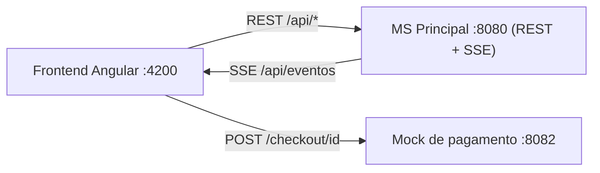
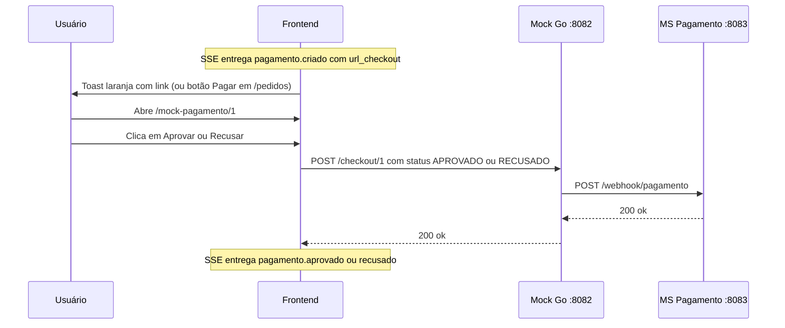

# Frontend (Angular)

Este documento explica como o frontend funciona: estrutura, rotas, serviços, a conexão SSE e o fluxo de pagamento. Os outros dois documentos complementam este:

- [`backend.md`](backend.md): microsserviços, bancos e infraestrutura.
- [`rabbitmq-e-eventos.md`](rabbitmq-e-eventos.md): filas, eventos, segurança das mensagens, SSE e webhook.

## 1. Visão geral

- Aplicação Angular (componentes standalone, `signal` para estado e o decorator `@Service()` nos serviços), servida pelo `ng serve` em `http://localhost:4200`.
- O frontend conversa com **um único backend**, o MS Principal (`http://localhost:8080/api`), que é o ponto de entrada do sistema.
- Exceção: a página do **mock de pagamento** chama diretamente o mock em Go (`http://localhost:8082`). Em um sistema real, essa etapa seria uma página do provedor de pagamento.
- O estado dos pedidos é atualizado em tempo real por **SSE** (Server-Sent Events), sem polling.



## 2. Estrutura de pastas

Estrutura deduzida dos imports (`src/app/`):

```
src/app/
├── app.ts / app.html / app.routes.ts
├── layout/
│   └── header/header.ts            # cabeçalho com a navegação
└── features/
    ├── catalogo/                   # lista e pesquisa de produtos
    ├── carrinho/                   # produtos escolhidos e criação do pedido
    ├── pedidos/                    # lista de pedidos, situação, pagar, remover
    ├── notificacoes/               # cadastro de interesse em promoções
    ├── mock-pagamento/             # página de checkout simulada
    ├── toast-container/            # notificações no canto da tela
    └── services/
        ├── produtos.ts
        ├── carrinho.ts
        ├── pedidos.ts              # inclui a conexão SSE
        ├── notificacoes.ts         # serviço das promoções (não é o toast)
        └── toast.ts                # serviço do toast
```

> **Atenção ao nome:** `notificacoes` (promoções por e-mail) e `toast` (aviso na tela) são coisas diferentes. O toast foi nomeado assim justamente para não colidir com o `NotificacoesService` das promoções.

## 3. Rotas

| Rota | Componente | Função |
|---|---|---|
| `/` | `Catalogo` | Lista e pesquisa produtos |
| `/carrinho` | `Carrinho` | Define quantidades e cria o pedido |
| `/pedidos` | `Pedidos` | Lista pedidos e suas situações |
| `/notificacoes` | `Notificacoes` | Cadastro de interesse em promoções |
| `/mock-pagamento/:pedidoId` | `MockPagamento` | Aprovar ou recusar o pagamento (mock) |
| `**` | redireciona para `/` | Rota desconhecida |

## 4. Componente raiz (`App`)

```typescript
export class App {
  constructor() {
    inject(PedidosService).conectarSSE();
  }
}
```

```html
<app-header/>
<app-toast-container />
<router-outlet/>
```

Duas decisões importantes:

1. **O SSE é aberto no `App`, uma única vez.** Se a conexão ficasse em um componente de página (como era antes, na página de pedidos), ela fecharia ao trocar de rota, e os eventos recebidos nesse intervalo seriam perdidos. No `App`, a conexão vive enquanto a aplicação estiver aberta.
2. **O `<app-toast-container />` fica fora do `<router-outlet>`.** Por isso as notificações aparecem em qualquer página.

## 5. Serviços

### 5.1 `ProdutosService`

`GET /api/produtos` com parâmetros opcionais:

- `nome_like`: busca por nome (parcial, sem diferenciar maiúsculas).
- `id`: repetível (`?id=1&id=2`), para buscar produtos específicos.

Retorna `ProdutoDTO[]`: `{ id, nome, categoria, quantidadeDisponivel }`.

> O backend só devolve produtos com saldo disponível maior que zero (`quantidade - reservados > 0`). Veja os pontos de atenção na seção 10.

### 5.2 `CarrinhoService`

Guarda dois conjuntos de dados, ambos em memória (somem ao recarregar a página):

- `produtos` (signal): produtos marcados no catálogo, ainda sem quantidade definida.
- `produtosProntos`: produtos com a quantidade escolhida (`{ produtoId, quantidade }`).

Métodos principais: `adicionarProduto`, `removerProduto`, `adicionarProdutoPronto` (cria ou atualiza a quantidade, sem duplicar o mesmo produto), `temProdutoPronto` e `limpar` (remove do carrinho os produtos que já têm quantidade, depois de criar o pedido).

### 5.3 `PedidosService`

Concentra tudo relacionado a pedidos. Mantém um `signal` com a lista de pedidos (`PedidoResponse[]`: `id`, `situacao` e `produtos`, um mapa de id do produto para quantidade).

| Método | O que faz |
|---|---|
| `recarregarPedidos()` | `GET /api/pedidos` e substitui a lista |
| `getPedidos()` | Devolve a lista atual (lê o signal) |
| `criarPedido(produtosProntos)` | `POST /api/pedidos` com `{ itens: [{ produto_id, quantidade }] }` |
| `removerPedido(id)` | `DELETE /api/pedidos/{id}` e remove da lista local |
| `obterProdutosPedido(id)` | Busca os dados dos produtos do pedido em `/api/produtos?id=...` |
| `obterQuantidadeRequisitada(pedidoId, produtoId)` | Quantidade pedida de um produto |
| `conectarSSE()` / `desconectarSSE()` | Abre e fecha a conexão com `/api/eventos` |

O construtor já chama `recarregarPedidos()`, então a lista é carregada assim que o serviço é criado (isto é, na inicialização do `App`).

### 5.4 `ToastService` e `ToastContainer`

O `ToastService` guarda a lista de notificações em um signal. O método `exibir(dados, duracaoMs)` adiciona uma notificação; com `duracaoMs = null` ela só some quando o usuário fecha. O padrão é 6000 ms.

O `ToastContainer` desenha as notificações no canto superior direito (`position: fixed`), com animação de entrada, botão de fechar e link opcional. A cor depende do tipo:

| Tipo | Cor |
|---|---|
| `sucesso` | verde |
| `erro` | vermelho |
| `aviso` | laranja |
| `info` | azul |

### 5.5 `NotificacoesService` (promoções)

`POST /api/promocoes/interesse` com `{ email, categorias, acao }`. O backend sobrescreve `acao` para `"CADASTRAR"`. A tela só cadastra; o cancelamento existe na API (`DELETE /api/promocoes/interesse?email=`), mas não tem botão no frontend.

## 6. Páginas

- **Catálogo:** carrega todos os produtos ao abrir. A pesquisa dispara com Enter ou ao clicar na lupa. O botão "Adicionar no carrinho" fica desabilitado se o produto está sem saldo ou já está no carrinho.
- **Carrinho:** *a confirmar.* O componente não foi analisado. Pelo serviço, é aqui que se define a quantidade de cada produto e se chama `criarPedido`.
- **Pedidos:** lista os pedidos com o ID e um badge colorido da situação. Cada pedido tem três ações: **Pagar** (aparece só quando a situação é `ESTOQUE_DISPONIVEL` e leva a `/mock-pagamento/{id}`), **Ver produtos** (diálogo com os produtos e quantidades) e **Remover** (ícone de lixeira).
- **Notificações:** escolha das categorias A, B e C e do e-mail; envia o cadastro de interesse.
- **Mock de pagamento:** mostra os botões "Aprovar" e "Recusar" (seção 8).

Cores dos badges de situação:

| Situação | Cor |
|---|---|
| `CRIADO` | cinza |
| `ESTOQUE_DISPONIVEL` | azul |
| `ESTOQUE_INDISPONIVEL` | vermelho |
| `PAGAMENTO_APROVADO` | verde-água |
| `PAGAMENTO_RECUSADO` | vermelho |
| `ENVIADO` | verde |

## 7. Conexão SSE e toasts

O SSE é a forma de o backend "empurrar" mudanças de situação para o navegador. O lado do servidor está explicado em [`rabbitmq-e-eventos.md`](rabbitmq-e-eventos.md). No frontend, a lógica está no `PedidosService.conectarSSE()`:

```typescript
this.eventSource = new EventSource('http://localhost:8080/api/eventos');

this.eventSource.onopen = () => this.recarregarPedidos();

this.eventSource.addEventListener('message', (e: MessageEvent) => {
  const ev: EventoPedido = JSON.parse(e.data);
  // 1. atualiza a situação do pedido na lista
  // 2. mostra o toast correspondente
});
```

Pontos importantes:

- **Nome do evento:** o servidor envia `event: message`, por isso o listener é o de `'message'`.
- **Payload** (`EventoPedido`): `{ tipo, pedido_id, situacao, url_checkout? }`.
- **Sem duplicar conexões:** `conectarSSE()` retorna logo se já existe uma conexão.
- **Sincronização ao conectar:** o servidor descarta eventos quando não há ninguém conectado. Por isso, a cada abertura (inclusive reconexões automáticas do navegador), o front chama `recarregarPedidos()` e recupera o estado atual.
- **Reconexão:** o `EventSource` reconecta sozinho se a conexão cair; o `onerror` só registra o erro no console.

Tabela de eventos e toasts:

| `tipo` do evento | Toast | Texto |
|---|---|---|
| `pedido.estoque_ok` | azul | "Estoque confirmado" |
| `estoque.indisponivel` | vermelho | "Estoque indisponível" |
| `pagamento.criado` | laranja, **com link**, fica até fechar | "Aguardando pagamento" |
| `pagamento.aprovado` | verde | "Pagamento aprovado" |
| `pagamento.recusado` | vermelho | "Pagamento recusado" |
| `pedido.enviado` | verde | "Pedido enviado" |

## 8. Fluxo de pagamento no frontend



Duas formas de chegar à página de pagamento:

1. **O link do toast** (`url_checkout`), que abre uma nova aba.
2. **O botão "Pagar"** na página de pedidos, útil quando o toast foi fechado ou a página foi recarregada. Funciona porque a URL segue um padrão fixo (`/mock-pagamento/{id}`).

A página `MockPagamento` lê o `pedidoId` da rota e tem cinco estados: aguardando, enviando, aprovado, recusado e erro. A mensagem de erro vem do campo `erro` da resposta do mock (por exemplo, "cobrança não encontrada ou já respondida").

> O resultado do pagamento **não atualiza a lista de pedidos pela própria página do mock**. Quem atualiza é o SSE, na conexão da aba principal. Se o link abriu em uma nova aba, essa aba também tem a própria conexão SSE (o `App` carrega nela também).

## 9. Como rodar

```bash
make frontend        # npm install e ng serve (http://localhost:4200)
make dev             # sobe o projeto completo, incluindo o frontend
```

O backend precisa estar no ar para as páginas funcionarem.

## 10. Pontos de atenção e limitações

- **URLs fixas no código** (`http://localhost:8080`, `:8082`). Para outros ambientes, vale centralizá-las em um arquivo de configuração (`environment`).
- **Diálogo "Ver produtos" pode vir incompleto.** Ele busca os produtos em `GET /api/produtos?id=...`, que só devolve produtos com saldo disponível maior que zero. Se um pedido reservar todo o saldo restante de um produto, esse produto some do diálogo (o saldo disponível passa a ser zero).
- **O carrinho é volátil:** fica só em memória; recarregar a página limpa tudo.
- **Eventos perdidos:** se o navegador estiver fechado quando um evento ocorre, não há toast. O estado correto é recuperado ao reabrir, pelo `recarregarPedidos()`, mas o aviso em si é perdido.
- **O link de pagamento depende do mock:** o botão "Pagar" abre uma página que só funciona se o mock estiver no ar e a cobrança ainda estiver pendente.
- **Cancelamento de promoções** não tem tela, apesar de existir na API.
