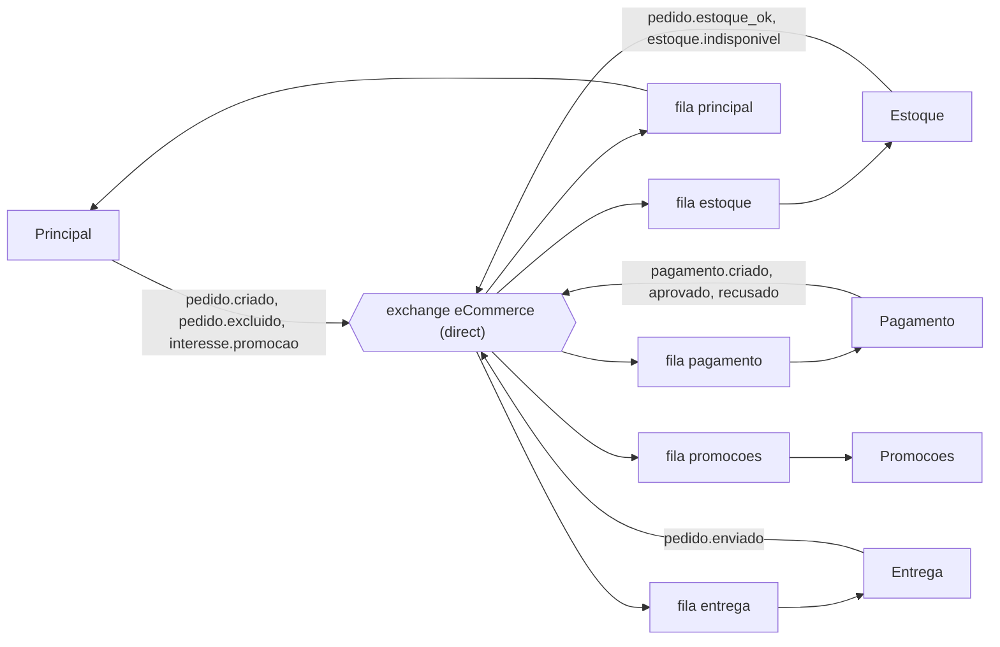
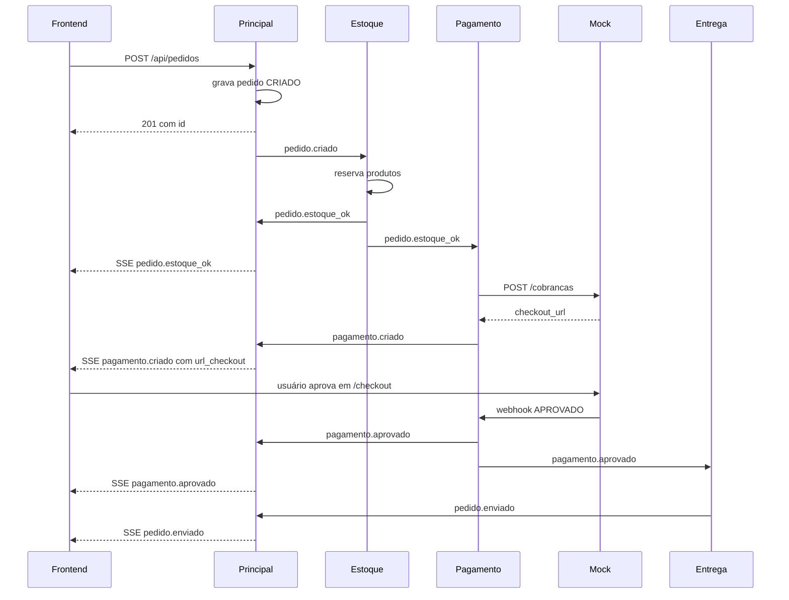
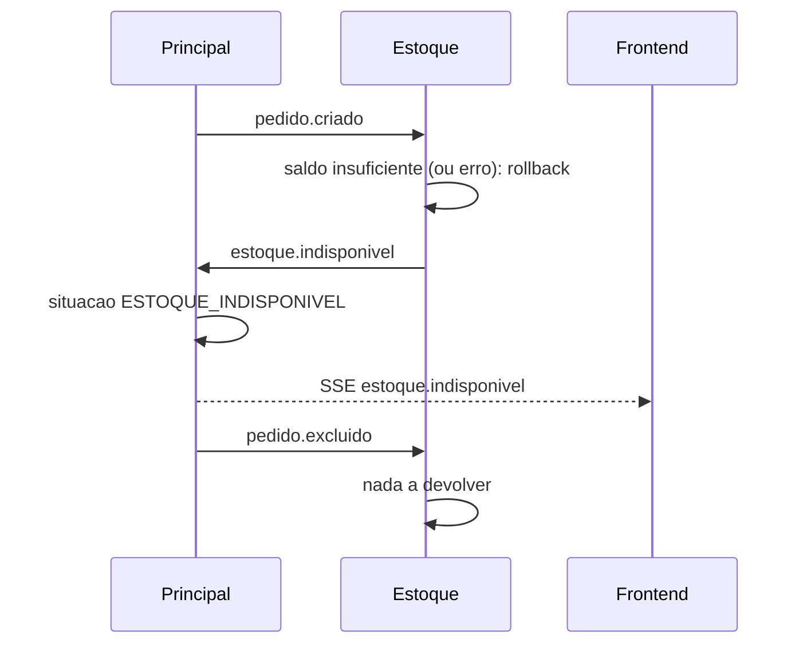
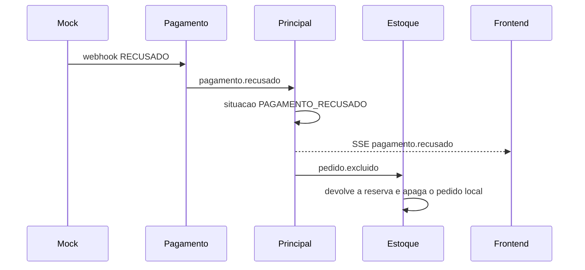

# RabbitMQ, eventos, SSE e webhook

Este documento explica a comunicação assíncrona do sistema: como o RabbitMQ está configurado, quais eventos existem e quem os produz e consome, como as mensagens são assinadas, e como o resultado chega ao navegador (SSE) e ao MS Pagamento (webhook). Documentos relacionados:

- [`backend.md`](backend.md): cada microsserviço, os bancos e a infraestrutura.
- [`frontend.md`](frontend.md): como o Angular consome o SSE e mostra os toasts.

## 1. Visão geral

Os microsserviços não chamam uns aos outros para executar o fluxo do pedido. Em vez disso, cada um **publica eventos** ("o pedido foi criado", "o pagamento foi aprovado") e **reage** aos eventos que lhe interessam. O RabbitMQ é o intermediário.

Conceitos usados aqui:

| Termo | Significado neste projeto |
|---|---|
| **Exchange** | Ponto de entrada das mensagens. Todos publicam na exchange `eCommerce`. |
| **Routing key** | O "assunto" da mensagem, como `pedido.criado`. A exchange usa isso para decidir o destino. |
| **Fila** | Onde as mensagens esperam. Cada microsserviço tem a sua. |
| **Binding** | Regra "esta fila recebe esta routing key". |

## 2. Topologia

Criada por `go run ./setup/main` (arquivo `setup/rabbitmq.go`).

**Exchange `eCommerce`:** tipo `direct`, durável. Uma mensagem vai para as filas cujo binding tem **exatamente** a routing key da mensagem.

| Fila | Routing keys recebidas |
|---|---|
| `estoque` | `pedido.criado`, `pedido.excluido` |
| `principal` | `pedido.estoque_ok`, `estoque.indisponivel`, `pagamento.criado`, `pagamento.aprovado`, `pagamento.recusado`, `pedido.enviado` |
| `pagamento` | `pedido.estoque_ok` |
| `entrega` | `pagamento.aprovado` |
| `promocoes` | `interesse.promocao` |

Todas as filas são duráveis. Algumas routing keys aparecem em mais de uma fila (`pedido.estoque_ok` vai para `principal` e `pagamento`; `pagamento.aprovado` vai para `principal` e `entrega`). Isso é intencional: a mesma mensagem é **copiada para as duas filas**, e cada consumidor processa a sua cópia.

**Exchange `Promoções`:** tipo `topic`, com as filas `Q1` (routing keys `promocao.categoria.A` e `promocao.categoria.B`) e `Q2` (`promocao.categoria.*`). Foram criadas no setup, mas o MS Promoções analisado não publica nelas (ele envia e-mails diretamente). Provavelmente pertencem à pasta `consumidor/`, que não foi analisada.



## 3. Catálogo de eventos

Todos os eventos viajam dentro do envelope assinado descrito na seção 5. A coluna "Payload" mostra o conteúdo do campo `payload`.

| Routing key | Publicado por | Consumido por | Payload | O que acontece |
|---|---|---|---|---|
| `pedido.criado` | Principal | Estoque | `{ "pedido_id": 1, "itens": [ { "produto_id": 1, "quantidade": 2 } ] }` | Estoque verifica e reserva |
| `pedido.excluido` | Principal | Estoque | `{ "pedido_id": 1 }` | Estoque devolve a reserva e apaga o pedido local |
| `pedido.estoque_ok` | Estoque | Principal, Pagamento | `{ "pedido_id": 1 }` | Principal: `ESTOQUE_DISPONIVEL`. Pagamento: cria a cobrança |
| `estoque.indisponivel` | Estoque | Principal | `{ "pedido_id": 1 }` | Principal: `ESTOQUE_INDISPONIVEL` e publica `pedido.excluido` |
| `pagamento.criado` | Pagamento | Principal | `{ "pedido_id": 1, "url_checkout": "http://..." }` | Principal só repassa ao SSE (a situação não muda) |
| `pagamento.aprovado` | Pagamento | Principal, Entrega | `{ "pedido_id": 1 }` | Principal: `PAGAMENTO_APROVADO`. Entrega: prepara o envio |
| `pagamento.recusado` | Pagamento | Principal | `{ "pedido_id": 1 }` | Principal: `PAGAMENTO_RECUSADO` e publica `pedido.excluido` |
| `pedido.enviado` | Entrega | Principal | `{ "pedido_id": 1, "nota_id": "..." }` | Principal: `ENVIADO` |
| `interesse.promocao` | Principal | Promoções | `{ "email": "a@b.com", "categorias": ["A","C"], "acao": "CADASTRAR" }` | Promoções grava ou apaga o interesse (`CADASTRAR` ou `CANCELAR`) |

O `pedido.excluido` é publicado pelo Principal em **três** situações: quando o usuário exclui o pedido, quando o estoque é indisponível e quando o pagamento é recusado. Nos dois últimos casos, o pedido continua no banco do Principal (só muda a situação).

## 4. Fluxos completos

### 4.1 Caminho feliz



### 4.2 Estoque indisponível



### 4.3 Pagamento recusado



O mesmo caminho acontece se o provedor de pagamento estiver fora do ar quando o MS Pagamento tenta criar a cobrança: o serviço publica `pagamento.recusado` por conta própria.

## 5. Segurança das mensagens (assinatura)

O pacote `seguranca` garante que uma mensagem foi realmente produzida por quem diz ter produzido, e que não foi alterada no caminho.

### Envelope

Toda mensagem publicada tem este formato no corpo AMQP:

```json
{
  "payload":   { "pedido_id": 1 },
  "producer":  "estoque",
  "signature": "<assinatura em base64>"
}
```

### Como é criada (`CriarPacote`)

1. Serializa o payload em JSON.
2. Monta o texto `producer + ":" + payload` e calcula o **SHA-256**.
3. Assina o hash com a **chave privada Ed25519** do serviço.
4. Devolve o envelope com o payload, o nome do produtor e a assinatura.

### Como é verificada (`AbrirPacote`)

1. Lê o envelope e procura a chave pública do `producer` no mapa de chaves carregado na inicialização. Se não existe, descarta.
2. Recalcula o hash do mesmo jeito e verifica a assinatura. Se for inválida, **descarta a mensagem** (o consumidor registra o erro e segue para a próxima).
3. Só então entrega o `payload` para o código de negócio.

### Chaves

Geradas por `GerarChaves()` (chamada pelo setup), uma vez por execução do `make setup`/`make dev`:

- Cada serviço (`principal`, `estoque`, `pagamento`, `entrega`, `promocoes`) recebe um par Ed25519 em `ms-<nome>/chaves/`: `<nome>_private.pem` (permissão `0600`) e `<nome>_public.pem`.
- A chave **pública** de cada serviço é copiada para a pasta `chaves/` de todos os outros. A chave privada **nunca** sai da pasta do dono.
- A chave pública do Promoções também é copiada para `consumidor/chaves/`.
- Cada serviço carrega suas chaves de `ms-<nome>/chaves/` ao iniciar: a própria privada (para assinar) e todas as públicas (para verificar).

> Como as chaves são **regeneradas a cada setup**, todos os serviços precisam ser iniciados depois dele. Se um serviço antigo continuar rodando com chaves antigas, as mensagens dele serão descartadas com "assinatura inválida".

### O que a assinatura garante e o que não garante

| Garante | Não garante |
|---|---|
| **Autenticidade:** quem assinou tem a chave privada do produtor | **Confidencialidade:** o payload viaja em texto, apenas assinado (as mensagens de log dizem "descriptografar", mas nada é criptografado) |
| **Integridade:** o payload não foi alterado | **Proteção contra repetição:** não há *timestamp* nem *nonce*; uma mensagem válida capturada pode ser reenviada |
| | **Autorização por tipo de evento:** qualquer serviço com chave válida poderia publicar qualquer routing key |

## 6. Webhook de pagamento

O webhook é a forma de o provedor de pagamento avisar o MS Pagamento do resultado, **de forma assíncrona**: o provedor chama o sistema quando o usuário decide, em vez de o sistema ficar perguntando.

**Endpoint:** `POST http://localhost:8083/webhook/pagamento`

```json
{ "pedido_id": 1, "status": "APROVADO" }
```

`status` aceita `APROVADO` ou `RECUSADO`.

**Resposta:**

| Código | Quando |
|---|---|
| `200` | Resultado aceito e evento publicado (`{ "mensagem": "ok" }`) |
| `400` | JSON inválido, campo ausente ou status diferente de `APROVADO`/`RECUSADO` |
| `404` | O pedido não tem cobrança pendente (já respondida, inexistente ou serviço reiniciado) |
| `500` | Falha ao publicar no RabbitMQ. O pedido volta a ficar pendente para permitir nova tentativa |

**Como funciona por dentro:**

1. Ao criar a cobrança, o serviço registra o pedido em um mapa de **pendentes** (em memória).
2. Quando o webhook chega, ele remove o pedido dos pendentes (isso impede processar a mesma resposta duas vezes) e publica `pagamento.aprovado` ou `pagamento.recusado`.

**No projeto:** o "provedor" é o mock em Go (`:8082`). A página Angular chama o mock, e o mock chama o webhook com o `webhook_url` que recebeu na criação da cobrança.

**Limitação importante:** o webhook **não autentica o chamador**. Qualquer cliente que conheça o endereço pode aprovar um pagamento pendente. Provedores reais assinam as chamadas de webhook e o receptor verifica a assinatura. Aqui isso foi deixado de fora por ser um mock.

## 7. SSE (Server-Sent Events)

O SSE é uma conexão HTTP que fica **aberta**, pela qual o servidor envia eventos ao navegador, sempre no mesmo sentido (servidor → cliente). Aqui é o que atualiza a situação dos pedidos e dispara os toasts, sem polling.

**Endpoint:** `GET http://localhost:8080/api/eventos`

### Lado do servidor (`hub.go` do MS Principal)

- Cada conexão aberta recebe o **seu próprio canal** (buffer de 20 eventos), registrado no `hub`.
- Quando um evento do RabbitMQ chega ao Principal, o `broadcast()` entrega o evento a **todas** as conexões abertas.
- O `broadcast` **nunca bloqueia**: se o buffer de um cliente lento estiver cheio, o evento é descartado só para ele.
- Se **não há nenhum cliente conectado**, o evento é descartado (`[SSE] Nenhum cliente conectado...` no log).
- A cada 25 segundos o servidor envia um comentário (`: ping`) para manter a conexão viva, e no início envia `: conectado` para o navegador disparar o `onopen` na hora.
- Quando o navegador fecha a conexão, o canal é removido do hub.

### Formato da mensagem

```
event:message
data:{"tipo":"pagamento.aprovado","pedido_id":12,"situacao":"PAGAMENTO_APROVADO"}
```

Campos de `data` (`PayloadEvento`): `tipo`, `pedido_id`, `situacao` e, só em `pagamento.criado`, `url_checkout`.

| `tipo` | `situacao` enviada | Observação |
|---|---|---|
| `pedido.estoque_ok` | `ESTOQUE_DISPONIVEL` | |
| `estoque.indisponivel` | `ESTOQUE_INDISPONIVEL` | |
| `pagamento.criado` | `ESTOQUE_DISPONIVEL` | Leva `url_checkout`. Não está listado no `USOAPI.md`. |
| `pagamento.aprovado` | `PAGAMENTO_APROVADO` | |
| `pagamento.recusado` | `PAGAMENTO_RECUSADO` | |
| `pedido.enviado` | `ENVIADO` | |

### Lado do cliente

O Angular abre a conexão no `App` e escuta o evento `message`. Detalhes em [`frontend.md`](frontend.md#7-conexão-sse-e-toasts).

### Limitações do SSE neste projeto

- **Sem histórico:** eventos enviados enquanto ninguém está conectado são perdidos. O frontend compensa recarregando os pedidos (`GET /api/pedidos`) sempre que a conexão abre.
- **Sem filtro por usuário:** todos os clientes conectados recebem os eventos de **todos** os pedidos. O sistema não tem login nem a noção de "dono" do pedido.
- **Conexões longas atrapalham o desligamento:** ao encerrar o Principal, o *shutdown* pode estourar o tempo de 5 s (`context deadline exceeded`) se houver SSE aberto. É inofensivo.

## 8. Como publicar e consumir (padrões do código)

- **Dois canais por serviço:** um só para publicar, outro só para consumir.
- **Publicação concorrente:** no Principal e no Pagamento, vários trechos podem publicar ao mesmo tempo (handlers HTTP e consumidor). Como o canal AMQP não é seguro para isso, usa-se um `Mutex` em volta de cada publicação. No Estoque e na Entrega, só a goroutine do consumidor publica, então não há mutex.
- **`auto-ack = true`:** a mensagem é considerada entregue assim que sai da fila, antes de ser processada.
- **Consumidor exclusivo** nas filas `principal` e `estoque` (`exclusive = true`): só uma instância de cada pode consumir, então esses serviços não escalam horizontalmente sem mudar isso.
- **Descarte seguro:** mensagem com assinatura inválida, produtor desconhecido ou JSON incorreto é registrada no log e ignorada, sem derrubar o serviço.

### Garantias de entrega (e o que falta)

O desenho oferece, no máximo, **"no máximo uma vez"** (*at most once*):

- Com `auto-ack`, se o serviço cair no meio do processamento, a mensagem se perde.
- As mensagens não são marcadas como persistentes (as filas são duráveis, mas as mensagens, não); um reinício do RabbitMQ pode apagar mensagens que estavam na fila.
- Publicações usam `mandatory = false`: se nenhuma fila estiver ligada à routing key, a mensagem é descartada em silêncio.
- Não há reenvio automático nem fila de mensagens mortas (*dead letter*).

Para o contexto do projeto isso é aceitável. Em produção, o caminho seria *ack* manual, mensagens persistentes, *dead letter* e idempotência nos consumidores (o Estoque já trata `pedido.criado` duplicado).

## 9. Depuração

**Painel do RabbitMQ:** `http://localhost:15672` (usuário e senha de acordo com o `.env`; o código usa `guest`). Em *Queues* dá para ver as filas, quantas mensagens estão prontas e quantos consumidores estão ligados.

**Ver o SSE sem o navegador:**

```bash
curl -N http://localhost:8080/api/eventos
```

**Prefixos dos logs:** `[INFO-MS-<SERVIÇO>]`, `[ERRO-MS-<SERVIÇO>]` e `[SSE]`.

Sintomas comuns:

| Sintoma no log | Causa provável |
|---|---|
| `assinatura inválida` ou `chave pública desconhecida` | Chaves regeneradas com serviços antigos ainda rodando. Reinicie tudo depois do setup. |
| `Falha ao processar pedido N: ... relation "pedidos" does not exist` | O `schema.sql` do estoque não foi aplicado |
| `mock indisponível ... connection refused` na porta 8082 | O mock de pagamento não está rodando |
| `[SSE] Nenhum cliente conectado. Evento ... descartado` | Nenhum navegador estava com a aplicação aberta (ou o SSE não conectou) |
| `Falha ao conectar no RabbitMQ` | Container parado, ou usuário e senha diferentes de `guest` |
| Pedido parado em `CRIADO` | `pedido.criado` não foi publicado ou o Estoque não está rodando |
| Pedido parado em `ESTOQUE_DISPONIVEL` | Aguardando pagamento (use o link do toast ou o botão "Pagar") ou o MS Pagamento está fora |
